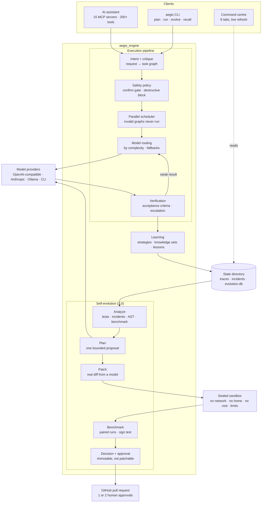
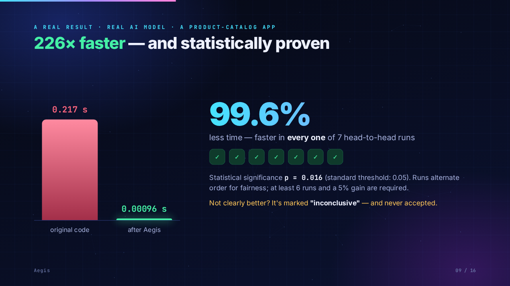
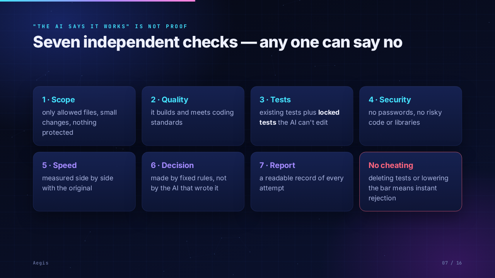
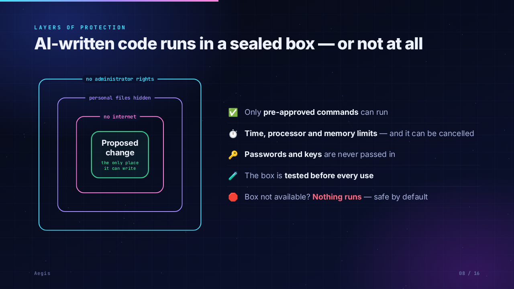
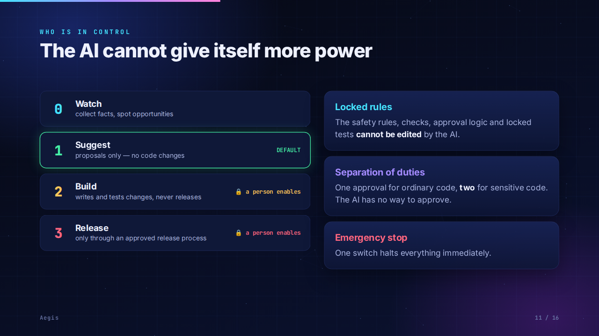
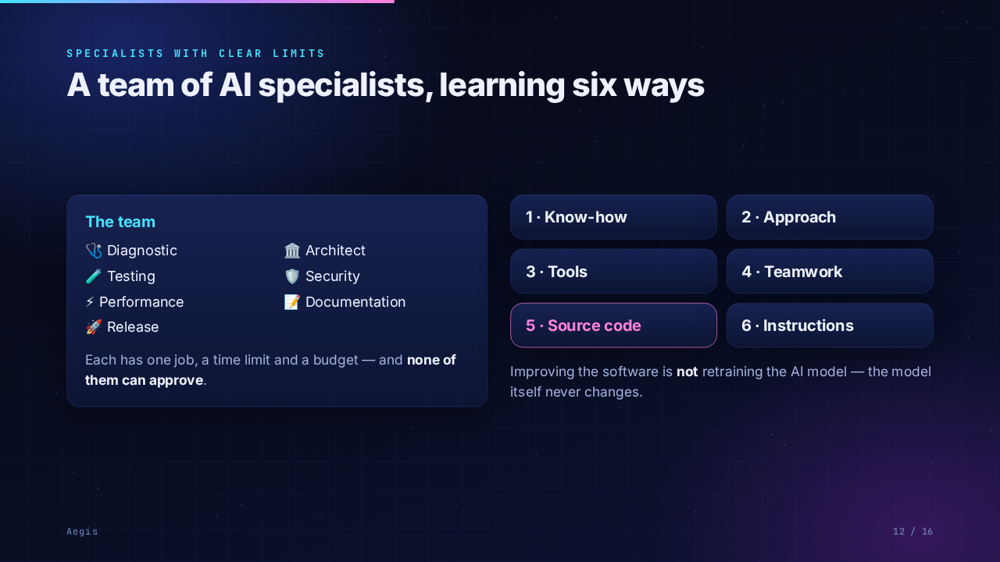
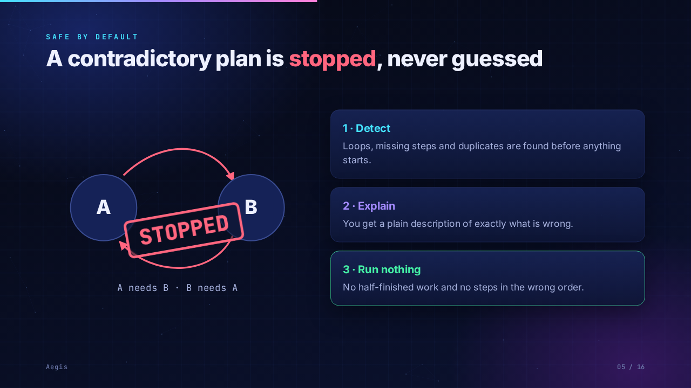
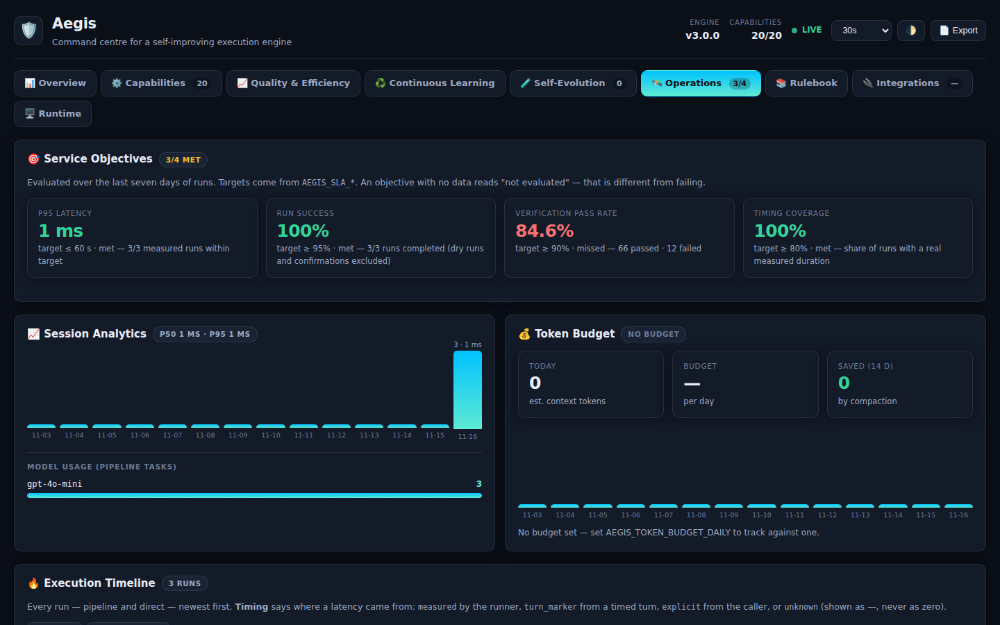
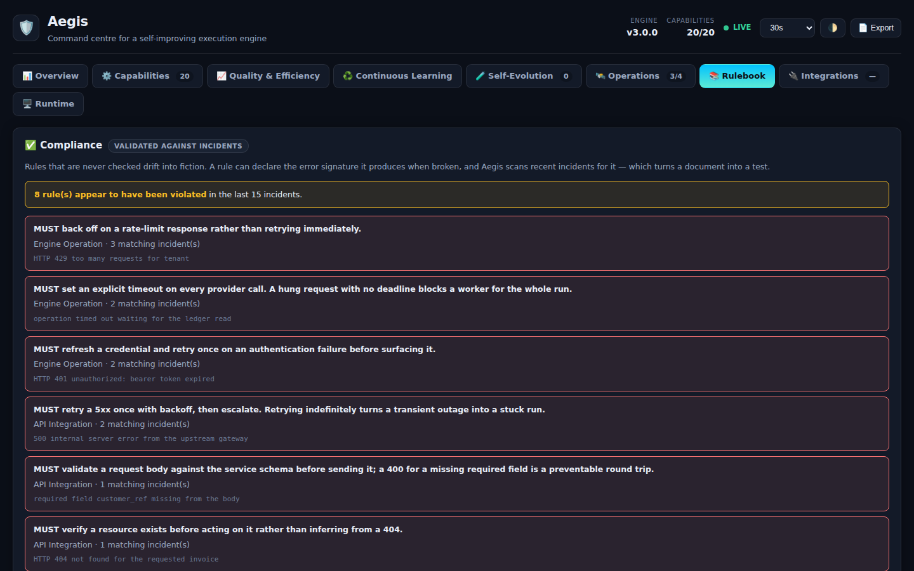
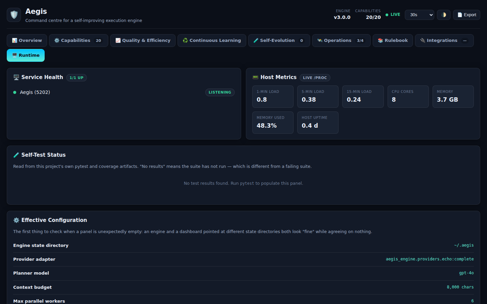

# Aegis — Self-Improving Execution Engine for LLM Work

**Software that improves its own code, and is never allowed to approve its own changes.**

Aegis plans every request, sends each step to the cheapest model that can handle it, checks the result against
acceptance criteria, blocks unsafe actions before anything runs, and learns from its own failures. Since 3.0 it
also **improves its own source code**: it finds a measured weak spot, has a model write one small patch, tests it
in a sealed sandbox, proves the gain with statistics and prepares a pull request that **a person approves**.

## Live architecture

**Three parts, one safe loop.** You ask the **AI assistant**, which is connected to 15 MCP servers (200+
everyday tools for issues, wiki and builds). The **task planner** turns the request into a checked, parallel
plan. When code should change, the **Aegis engine** finds, fixes, tests, measures and proposes the change.
Generated code runs only inside the **sealed test box**, and every change ends as a pull request for **human
review**.

▶ **[Watch the full animated explainer](https://buildsbeyondai-code.github.io/Aegis/explainer/)**: 16 slides,
about 3½ minutes. Use the arrow keys or the space bar to pause.

### Inside the engine

**How a request flows**
1. A request arrives from the AI assistant, the CLI or the command centre.
2. **Intent and critique** turn it into a dependency-aware task graph. A graph with a cycle, a missing step or a
   duplicate is **stopped and explained, never guessed**.
3. **Safety policy** stops the run before any cost if it needs confirmation or would do something destructive.
4. The **scheduler** runs independent steps in parallel, and **routing** sends each one to the cheapest model
   that fits, stepping down a fallback chain if a model is unavailable.
5. **Verification** scores each result against acceptance criteria and escalates a weak result to a stronger
   model.
6. Outcomes feed **learning**: a recurring failure becomes a reusable strategy, and every run is traced.
7. When the evidence shows a **confirmed** problem (a failing test, a recorded incident or a missed benchmark
   target), the **self-evolution** cycle can propose a code change.

## The improvement cycle

`observe → analyze → plan → patch → validate → benchmark → review → learn`

Every cycle is recorded step by step. If it is interrupted, it resumes where it left off and never runs twice.
The cheap phases gate the expensive ones: no confirmed finding means no code change.

| Step | What it does | What it is not allowed to do |
|---|---|---|
| Plan | One proposal in a fixed schema, with evidence and checkable acceptance criteria | Name a file the findings do not implicate, or set its own risk level |
| Patch | A real diff, applied in a separate candidate workspace | Touch the real working tree |
| Validate | Static, functional and security checks inside the sandbox | Skip a check; a missing tool reads *skipped*, never *passed* |
| Benchmark | Paired runs in alternating order, judged by an exact sign test | Claim a gain the measurement cannot support |
| Review | An independent evaluator, then a branch and a draft pull request | Approve, merge or deploy anything |

## A real result: 226× faster, statistically proven

On a sample product-catalog app with a real model, Aegis found a nested linear scan, replaced it with a one-time
index and cut the benchmark from **0.217 s to 0.00096 s** (99.6% less time). It was faster in **7 of 7**
head-to-head runs (sign test **p = 0.016**). Existing tests, locked tests and the security checks all passed,
and the change waited for a person to approve it.

## Features

### Seven independent checks; any one can say no

Scope, quality, tests (including **locked tests the AI cannot edit**), security, speed, a decision made by fixed
rules and a readable report. Deleting a test, adding a skip, moving a threshold, disabling logging, weakening
TLS or the sandbox, or adding `shell=True` or `eval` is rejected outright as a security event. The diff that is
tested is read back from disk, so a model that describes one change and writes another is caught.

### AI-written code runs in a sealed box, or not at all

A mandatory command allow-list, no shell, no network, a read-only root, a private `/tmp`, the home directory
hidden, every capability dropped, CPU, memory, file and process limits, a timeout and cancellation. The box is
tested before every use, and **if the host cannot provide it, nothing runs**.

### The AI cannot give itself more power

- **Autonomy modes:** `observe` → `recommend` (default) → `autonomous_dev` → `controlled_promotion`. Raising the
  mode needs an operator setting the AI cannot change.
- **Three code tiers:** *open* (up to 5 files), *guarded* (the agent's own planning and evolution code: 2 files,
  no deletions, **two human approvals**) and *immutable* (policy, validation, decision, approval and the locked
  tests), which the agent can never patch.
- **Separation of duties** and an **emergency stop** that halts everything at once.

### A team of AI specialists, learning six ways

Diagnostic, architect, testing, security, performance, documentation and release specialists each have one job,
a time limit and a budget, and none of them can approve. The model itself is never retrained: Aegis improves
code, prompts, strategies and routing.

### Safe plans by default

- **The gates come before the cost:** a request that needs confirmation costs one planning call, not a
  half-executed plan.
- Around 17 destructive-action families (`rm -rf`, `drop table`, `git push --force`, `terraform destroy`,
  `kubectl delete` and more) are blocked unless confirmed.
- Read-only by default, loopback only, strict content security policy, no CDN (works air-gapped), secrets
  redacted before anything is written.

### 20 capabilities, each probed live

| Area | Capabilities |
|---|---|
| **Accuracy** | plan critique · result verification · confidence escalation · consensus voting · observability and eval harness |
| **Efficiency** | semantic retrieval · parallel task scheduler · plan/result cache · context compaction |
| **Safety** | risk and reversibility classification with destructive-action blocking |
| **Learning** | verification-driven evolution · strategy synthesis · knowledge sets · learning recall · incident clustering |
| **Reliability** | model fallback and aliases · per-tier reasoning effort · turn timing · secret redaction · lossless log rotation |

The dashboard imports every engine module and runs a real demo through each one, so nothing is reported as
working unless it is.

## Command centre: 9 tabs

| | |
|---|---|
|  **Overview**: health, runs, savings |  **Self-Evolution**: mode, cycles, approvals, AI budget |
|  **Operations**: service objectives, token budget, timeline |  **Quality & Efficiency**: pass rate, incidents, savings |
|  **Continuous Learning**: strategies and knowledge sets |  **Rulebook**: rules that are checked against real incidents |
|  **Integrations**: connected systems with live health |  **Runtime**: configuration and environment |

### Honest reporting
Aegis tells **zero** apart from **unknown**: too little data shows "insufficient signal" instead of a misleading
pass rate, an unmeasured duration shows `—` instead of zero, and benchmark savings are labelled as benchmarks.
With no model configured, the dashboard says so in a banner instead of pretending to evolve.

### Works with any model
The engine has **no third-party dependencies** and never imports a vendor SDK. Adapters cover OpenAI-compatible
APIs (OpenAI, Azure, Groq, Together, vLLM, LM Studio, Ollama), Anthropic and any command-line model. Switching
provider is a configuration change.

### Evidence, not adjectives

| Check | Result |
|---|---|
| Automated tests | **442 passed** |
| Locked safety (protected acceptance) tests | **34 passed** |
| Tests with a real AI model | **5 passed** |
| Code covered by tests | **82%** |
| Task-planner tests | **479 passed** |
| End-to-end browser tests | **28 passed** |
| Known-vulnerable libraries | **0** |
| Coding-standard violations | **0** |

### Honest limits
- Python is fully supported; JavaScript and TypeScript partly; Java is not yet tested.
- Code review integrates with GitHub only.
- The sealed box needs Linux and is not a full virtual machine.
- Safety controls are technical controls, not a legal compliance certificate.

*Screenshots show the dashboard with demo data plus the recorded 226× cycle. The animations come from the
Aegis explainer.*

## Source code
The source code is private. For access, collaboration or questions, contact **buildsbeyondai@gmail.com**.

---
© 2026 Jude Finney. All rights reserved.
