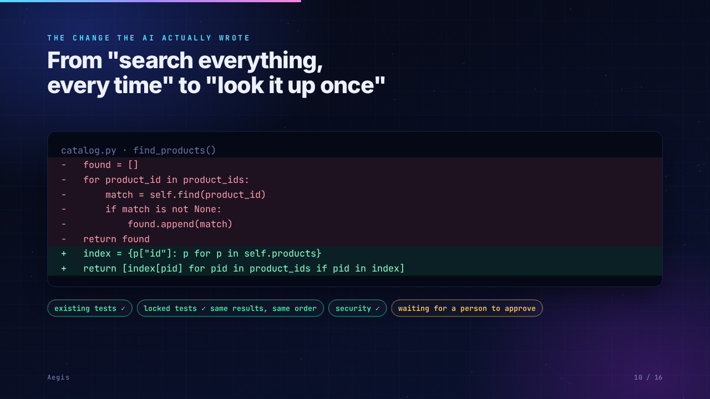
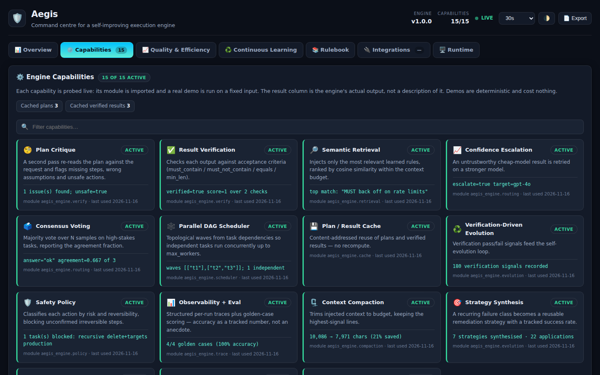
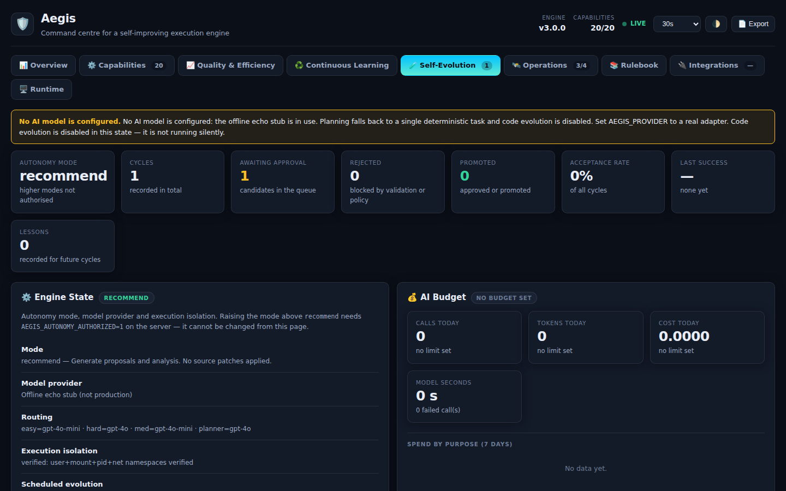
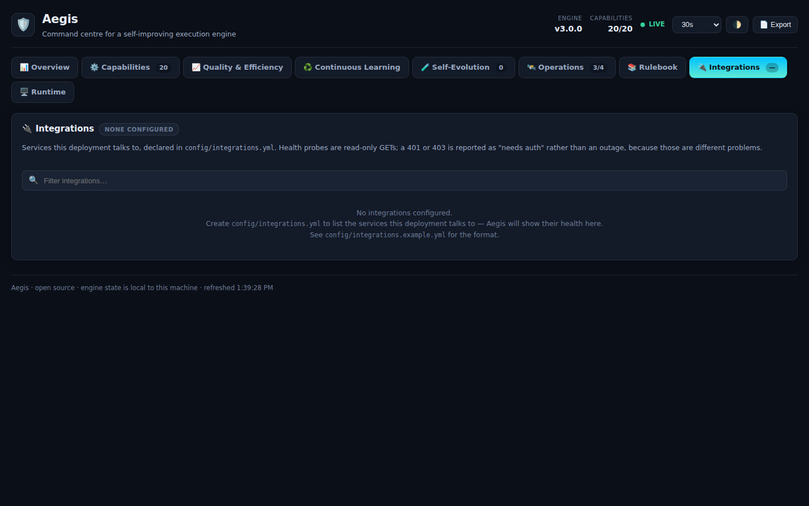

# Aegis — Self-Improving Execution Engine for LLM Work

**Software that improves its own code, and is never allowed to approve its own changes.**

Aegis plans every request, sends each step to the cheapest model that can handle it, checks the result against
acceptance criteria, blocks unsafe actions before anything runs, and learns from its own failures. Since 3.0 it
also improves its own source code, and every change ends as a pull request that a person approves.

## Live architecture

The AI assistant is connected to **15 MCP servers** (200+ tools), so work runs end to end from request to
verified result.

▶ **[Watch the full animated explainer](https://buildsbeyondai-code.github.io/Aegis/explainer/)** (16 slides,
about 3½ minutes; arrow keys to move, space to pause).

**How a request flows**
1. **Intent and critique** turn the request into a dependency-aware task graph. A graph with a cycle, a missing
   step or a duplicate is stopped and explained, never guessed.
2. **Safety policy** stops the run before any cost if it needs confirmation or would do something destructive.
3. The **scheduler** runs independent steps in parallel, and **routing** sends each one to the cheapest model
   that fits, stepping down a fallback chain if a model is unavailable.
4. **Verification** scores each result against acceptance criteria and escalates a weak result to a stronger
   model.
5. Outcomes feed **learning**: a recurring failure becomes a reusable strategy, and every run is traced.
6. When the evidence shows a **confirmed** problem (a failing test, a recorded incident or a missed benchmark
   target), the **improvement cycle** can propose a code change.

## The improvement cycle

| Step | What it does | What it is not allowed to do |
|---|---|---|
| Plan | One proposal with evidence and checkable acceptance criteria | Name a file the findings do not implicate, or set its own risk level |
| Patch | A real diff, applied in a separate candidate workspace | Touch the real working tree |
| Validate | Static, functional and security checks inside the sandbox | Skip a check; a missing tool reads *skipped*, never *passed* |
| Benchmark | Paired runs in alternating order, judged by an exact sign test | Claim a gain the measurement cannot support |
| Review | An independent evaluator, then a branch and a draft pull request | Approve, merge or deploy anything |

## A real result

On a sample product-catalog app with a real model, Aegis found a nested linear scan and replaced it with a
one-time index. The change passed every check and then waited for a person to approve it.

## Safety and control

The tested diff is read back from disk, so a model that describes one change and writes another is caught.

- **Three code tiers:** *open* (up to 5 files), *guarded* (the agent's own planning and evolution code: 2 files,
  no deletions, two approvals) and *immutable* (policy, validation, decision, approval and the locked tests).
- About 17 destructive-action families (`rm -rf`, `drop table`, `git push --force`, `terraform destroy`,
  `kubectl delete` and more) are blocked unless confirmed.
- Read-only by default, loopback only, strict content security policy, no CDN (works air-gapped), secrets
  redacted before anything is written.

## 20 capabilities, each probed live

| Area | Capabilities |
|---|---|
| **Accuracy** | plan critique · result verification · confidence escalation · consensus voting · observability and eval harness |
| **Efficiency** | semantic retrieval · parallel task scheduler · plan/result cache · context compaction |
| **Safety** | risk and reversibility classification with destructive-action blocking |
| **Learning** | verification-driven evolution · strategy synthesis · knowledge sets · learning recall · incident clustering |
| **Reliability** | model fallback and aliases · per-tier reasoning effort · turn timing · secret redaction · lossless log rotation |

The dashboard imports every engine module and runs a real demo through each one, so nothing is reported as
working unless it is.

## Command centre: 9 tabs

| | |
|---|---|
|  **Overview**: health, runs, savings |  **Self-Evolution**: mode, cycles, approvals, AI budget |
|  **Operations**: service objectives, token budget, timeline |  **Quality & Efficiency**: pass rate, incidents, savings |
|  **Continuous Learning**: strategies and knowledge sets |  **Rulebook**: rules checked against real incidents |
|  **Integrations**: connected systems with live health |  **Runtime**: configuration and environment |

Aegis tells **zero** apart from **unknown**: too little data shows "insufficient signal" instead of a misleading
number, and with no model configured the dashboard says so instead of pretending to work.

## Works with any model
The engine has **no third-party dependencies** and never imports a vendor SDK. Adapters cover OpenAI-compatible
APIs (OpenAI, Azure, Groq, Together, vLLM, LM Studio, Ollama), Anthropic and any command-line model.

## Evidence

| Check | Result |
|---|---|
| Automated tests | **442 passed** |
| Locked safety tests | **34 passed** |
| Tests with a real AI model | **5 passed** |
| Code covered by tests | **82%** |
| Known-vulnerable libraries | **0** |
| Coding-standard violations | **0** |

**Limits:** Python is fully supported, JavaScript and TypeScript partly, Java not yet tested. Code review
integrates with GitHub only. The sealed box needs Linux and is not a full virtual machine. Safety controls are
not a compliance certificate.

*Screenshots show the dashboard with demo data plus the recorded 226× cycle.*

## Source code
The source code is private. For access, collaboration or questions, contact **buildsbeyondai@gmail.com**.

---
© 2026 Jude Finney. All rights reserved.
