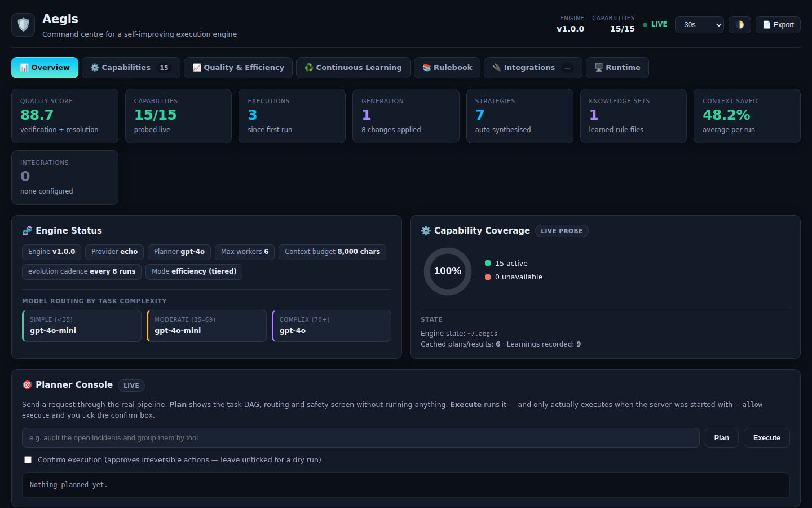
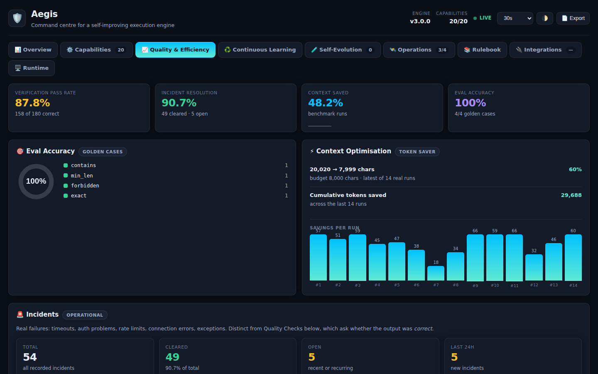
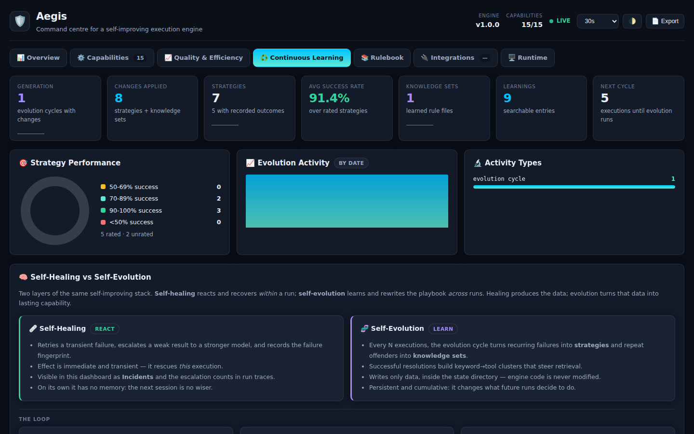

# Aegis — Self-Improving Execution Engine for LLM Work

**Running a language model inside a system is easy. Knowing whether it is doing a good job is not.**
Aegis plans every request, sends each step to the cheapest model that can handle it, checks the result against
acceptance criteria, blocks unsafe actions before anything runs, and learns from its own failures, with a
command centre that shows what it is doing.

The usual failure mode it is built to prevent: a pipeline that looks healthy (requests complete, no exceptions)
while quietly producing wrong answers, spending top-tier rates on trivial work, and re-learning the same lesson
every session because nothing was written down.



## Features

### Execution pipeline
Every request goes through ten stages:

```
request
   ├─ 1  plan cache          identical request? reuse the plan
   ├─ 2  intent              natural language → dependency-aware task graph
   ├─ 3  critique            missing steps, bad dependencies, unsafe verbs
   ├─ 4  confirm gate  ──▶  STOP  needs confirmation
   ├─ 5  policy screen ──▶  STOP  blocked by policy
   ├─ 6  schedule            parallel waves up to max_workers
   ├─ 7  execute             retrieve context → compact → executor
   ├─ 8  verify              score against acceptance criteria; escalate a weak result
   ├─ 9  cache + evolve      cache only verified output; feed outcomes to evolution
   └─ 10 trace               record the run
```

- **The gates come before the cost.** A request that needs confirmation costs one planning call, not a
  half-executed plan you have to unwind.
- **Model routing by task complexity:** simple, moderate and complex steps go to different models, so trivial
  work is never billed at top-tier rates.
- **Token saving:** plan and result caching plus context compaction, which keeps the highest-signal lines within
  a fixed context budget.
- **Enhancements degrade independently.** If retrieval, critique, caching or tracing fails, the run continues.

### 15 capabilities, each probed live


| Area | Capabilities |
|---|---|
| **Accuracy** | plan critique · result verification · confidence escalation · consensus voting · observability and eval harness |
| **Efficiency** | semantic retrieval · parallel task scheduler · plan/result cache · context compaction |
| **Safety** | risk and reversibility classification with destructive-action blocking |
| **Learning** | verification-driven evolution · strategy synthesis · knowledge sets · learning recall · incident clustering |

The dashboard imports every engine module and runs a real demo through each one, so nothing can be reported as
working unless it is.

### Quality and efficiency, measured



- Verification pass rate, incident resolution, context saved and eval accuracy on golden cases.
- Token savings per run and in total.
- Incidents grouped by type and by tool.

### Self-healing and self-evolution



- **Self-healing** (within one run): retry, escalate a weak result to a stronger model, record the failure.
- **Self-evolution** (across runs): a recurring failure class becomes a reusable **strategy** with a tracked
  success rate, and a tool with many failure classes earns a **knowledge set**, a rule file injected into later
  related tasks.
- Failures are fingerprinted, so `timeout after 30s` and `timeout after 91s` count as one class, not two.

### Safety by default
- Read-only by default; task execution needs an explicit flag **and** a per-request confirmation.
- Around 17 destructive-action pattern families (`rm -rf`, `drop table`, `git push --force`,
  `terraform destroy`, `kubectl delete` and more) are blocked unless confirmed.
- Loopback-only by default, strict content security policy, no CDN (works air-gapped), no `shell=True`
  anywhere.

### Honest reporting
Aegis tells **zero** apart from **unknown**: too little data shows "insufficient signal" instead of a misleading
pass rate, and benchmark savings are labelled as benchmarks.

### Connected end to end
- Deployed with **15 MCP servers connected**, giving the engine end-to-end tool access from planning to
  verified result.
- An integrations catalog lists every connected system with a live health probe (*up*, *needs auth*,
  *unreachable*) and the number of tools each one exposes.

### Works with any model
The engine has **no third-party dependencies** (standard library only) and never imports a vendor SDK.
Adapters cover OpenAI-compatible APIs (OpenAI, Azure, Groq, Together, vLLM, LM Studio, Ollama), Anthropic, and
any command-line model. Switching provider is a configuration change, and everything runs offline for testing.

### Engineering
- 308 automated tests, all passing.
- Python engine plus a Flask dashboard with seven tabs and a small HTTP API.

*Screenshots show the dashboard with demo data.*

## Source code
The source code is private. For access, collaboration or questions, contact **buildsbeyondai@gmail.com**.

---
© 2026 Jude Finney. All rights reserved.
